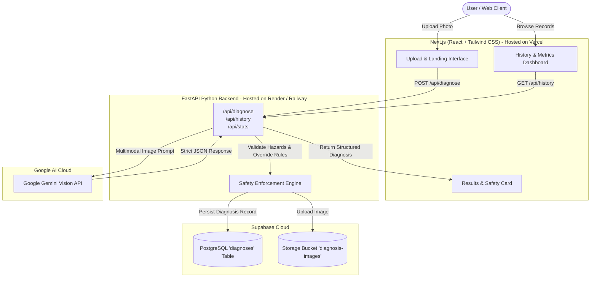

# YouFix - System Architecture & Engineering Specifications
**Capstone Project**: AI-Powered Fault Diagnosis & Safety Protocol Engine

---

## 1. System Overview

YouFix is a full-stack, multimodal AI platform designed to inspect physical damage in residential and automotive equipment. It uses **Google Gemini Vision** to extract diagnostic artifacts from user-uploaded images, strictly classifies the issue into 5 core domains, assesses life-safety hazard levels, and persists the audit record into **Supabase (PostgreSQL)**.



---

## 2. The 5 Strict Problem Domains

Gemini is strictly instructed to classify physical faults into **one of these 5 categories only**:

| Category | Typical Domain | Default Risk | Safety Action |
|---|---|---|---|
| **Leaking pipe** | Plumbing | Low | DIY Solvable (Tighten joint, replace washer, PTFE tape) |
| **Clogged drain** | Plumbing | Low | DIY Solvable (Clear stopper, snake P-trap, flush) |
| **Damaged electrical socket** | Electrical | **High** | **Professional Required** (Disconnect breaker, call licensed electrician) |
| **Flat tire** | Automotive | Medium | DIY Solvable (Wheel chocks, jack lift point, swap spare) |
| **Overheating engine** | Automotive | **High** | **Professional Required** (Pull over safely, shut off, never open hot radiator) |

---

## 3. Strict Safety Guardrails & Validation

In addition to system prompt constraints sent to Gemini Vision, the backend enforces programmatic Pydantic model validation (`GeminiDiagnosisOutput`):

```python
severe_categories = {
    CategoryEnum.DAMAGED_ELECTRICAL_SOCKET,
    CategoryEnum.OVERHEATING_ENGINE,
}

if self.category in severe_categories or self.risk_level == RiskLevelEnum.HIGH:
    self.professional_required = True
    self.is_diy = False
    # Guarantees safety_warning is populated
```

This ensures that even if an AI model hallucinated that a melted 240V socket could be fixed DIY, the backend validation rejects and overrides it, setting `professional_required = True` and injecting a non-negotiable electrocution warning.

---

## 4. API Endpoints Contract

### `POST /api/diagnose`
- **Request**: Multipart form data with `file` (JPEG, PNG, WebP up to 15MB).
- **Processing**:
  1. Validates file header and bytes.
  2. Sends image to Gemini Vision API.
  3. Uploads image to Supabase Storage bucket (`diagnosis-images`).
  4. Stores record into Supabase PostgreSQL table (`diagnoses`).
- **Response**: `201 Created` with full `DiagnosisResponse` JSON.

### `POST /api/diagnose-sample`
- **Request**: `{ "image_url": "https://...", "hint_category": "Leaking pipe" }`
- **Response**: `201 Created` with full diagnosis JSON.

### `GET /api/history`
- **Parameters**: `limit` (default 50), `offset` (default 0), `category` (optional), `risk_level` (optional).
- **Response**: Array of historical diagnosis records ordered by `created_at DESC`.

### `GET /api/diagnoses/{id}`
- **Parameters**: UUID string.
- **Response**: Detailed record or 404 Not Found.

### `GET /api/stats`
- **Response**: Diagnostic metrics (total scans, DIY count, Pro count, high risk alerts, category breakdown).

### `GET /health` or `GET /api/health`
- **Response**: Operational health status, version, and configuration indicators.

---

## 5. Hosting & Deployment Topology

- **Frontend**: Deployed on **Vercel** with global CDN edge routing and automatic HTTPS.
- **Backend**: Deployed on **Render** (via `render.yaml`) or **Railway** (via `railway.json` / `Dockerfile`).
- **Database**: **Supabase** Managed PostgreSQL with Row-Level Security (RLS) and S3-compatible Object Storage.
